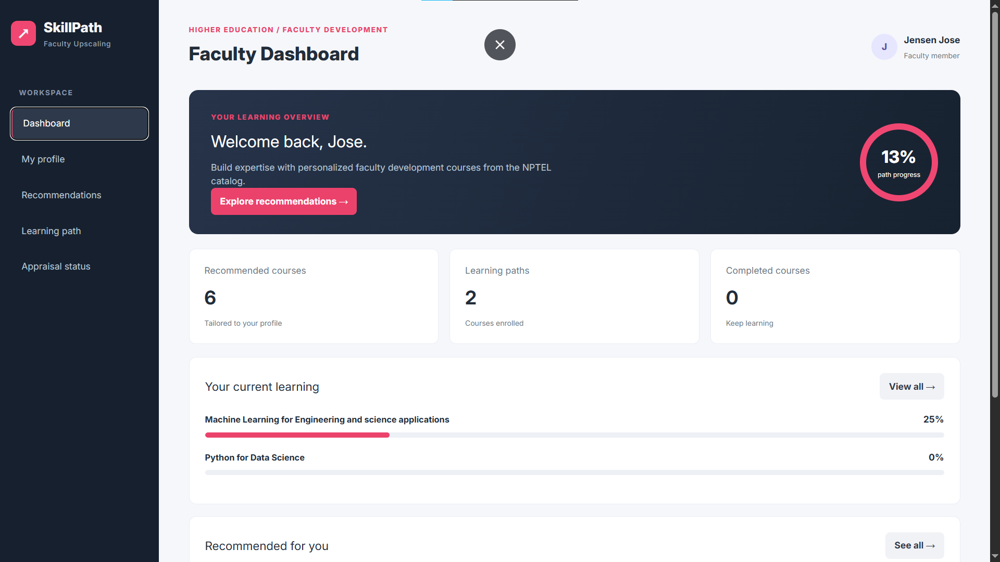
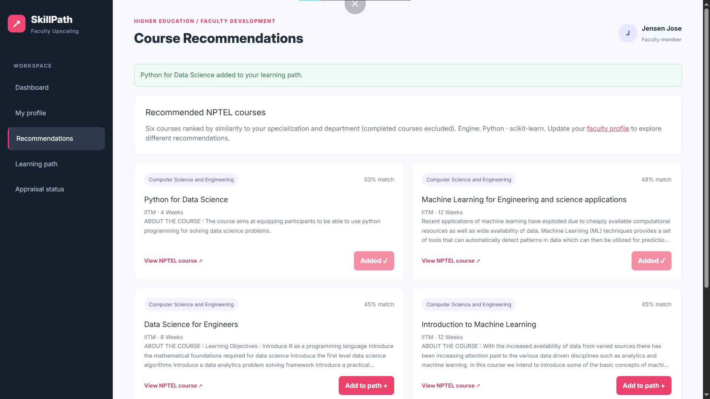
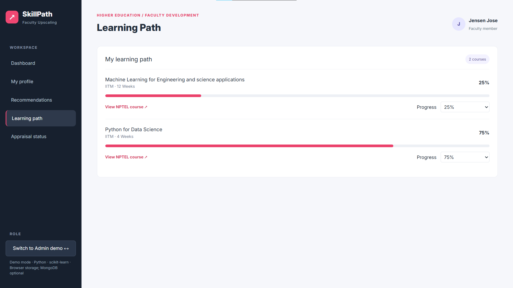
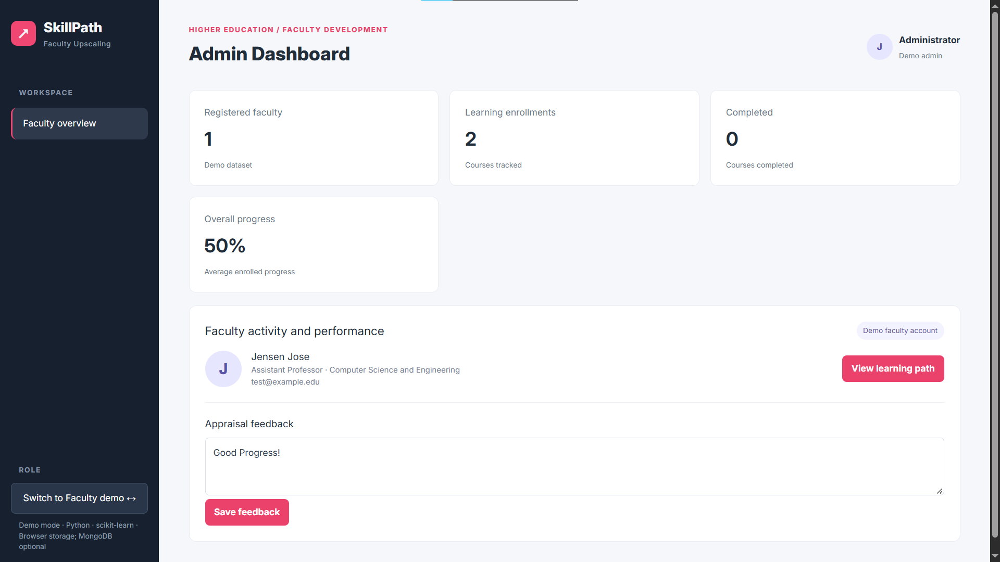

# Automated Web-Based Faculty Upscaling for Higher Education

A web-based faculty development platform that recommends NPTEL courses based on educators' academic backgrounds and professional interests. The application combines a React interface, an Express API, a Python content-based recommendation engine, and optional MongoDB persistence.

Originally developed as a B.Tech Computer Science and Engineering academic team project (2024), this repository contains a restored, demonstration-ready version.

## Application Preview

### Faculty Dashboard


### Personalized Course Recommendations


### Learning Path & Progress Tracking


### Admin Dashboard


## Features

- Faculty profile with designation, department, interests, and completed courses
- Six personalized NPTEL course recommendations
- Course details, prerequisites, durations, and available enrollment links
- Learning-path enrollment and manually updated progress tracking
- Appraisal feedback and a simplified administrator dashboard
- Optional MongoDB storage for the shared demonstration profile, progress, feedback, and generated recommendations
- Browser-based recommendation and localStorage fallback when the backend is unavailable

> The admin role switch is for demonstration only. This version does not implement secure multi-user authentication, authorization, Google sign-in, password reset, or integration with NPTEL completion records. Do not expose its unauthenticated API publicly or use real faculty personal information.

## Technology Stack

| Layer | Technology |
| --- | --- |
| Frontend | React, JavaScript, CSS |
| Backend | Node.js, Express |
| Recommendation engine | Python, NLTK, scikit-learn |
| Database | MongoDB, Mongoose (optional for local demos) |
| Course data | NPTEL Faculty Development Programme dataset |

## How Recommendations Work

1. Course titles and descriptions are read from `server/CourseSheet.csv`.
2. Course information is normalized and stemmed using NLTK's Porter stemmer.
3. scikit-learn's `CountVectorizer` converts text into numerical features.
4. Faculty interests, specialization, department, and designation are processed using the same vectorizer.
5. Cosine similarity ranks the available courses by relevance to the faculty profile.
6. The six highest-ranked eligible courses are returned, excluding exact titles already marked as completed.

The recommender is content-based: it does not use collaborative filtering, neural networks, or faculty performance labels. The vectorizer is rebuilt when the Python script runs, which is acceptable for this small dataset.

## Architecture

```text
React frontend (localhost:3000)
           |
           | HTTP requests
           v
Express API (localhost:5000) ---- MongoDB (optional)
           |
           | Starts Python for recommendation requests
           v
Python NLP recommender
           |
           v
NPTEL CSV + CountVectorizer + cosine similarity
```

Express starts `server/recommend.py` when the frontend requests new recommendations; Python does not run continuously. With MongoDB enabled, Express also saves generated recommendations to the shared demo document.

## Getting Started

### Requirements

- Node.js and npm
- Python 3.10 or newer
- MongoDB Community Server or MongoDB Atlas (optional)

### Run the backend

From the repository root:

```bash
cd server
python -m pip install -r requirements.txt
npm install
npm start
```

The Express API runs at `http://localhost:5000`.

### Run the frontend

Open another terminal from the repository root:

```bash
cd client
npm install
npm start
```

Open `http://localhost:3000`.

If the Express API is available, the frontend uses the Python recommender. Otherwise, it falls back to browser-based recommendations and localStorage for the demonstration.

## MongoDB Configuration

Copy `server/.env.example` to `server/.env` and configure the values:

```dotenv
PORT=5000
CLIENT_ORIGIN=http://localhost:3000
MONGODB_URI=mongodb://127.0.0.1:27017/faculty_upscaling
PYTHON_BIN=python
```

For MongoDB Atlas, replace `MONGODB_URI` with your own Atlas driver connection string, specifying the `faculty_upscaling` database. Keep passwords and other credentials out of version control.

After restarting Express, visit `http://localhost:5000/api/health` and check that `mongo` is `connected`.

The demonstration data is stored in:

```text
Database:   faculty_upscaling
Collection: demorecords
Document:   faculty-demo
```

The document holds faculty profile data, learning progress, appraisal feedback, and the most recently generated recommendations. Existing browser localStorage data may take precedence when reopening the frontend.

## API Endpoints

| Method | Endpoint | Description |
| --- | --- | --- |
| GET | `/api/health` | Check API and database status |
| POST | `/api/recommendations` | Generate six ranked recommendations with Python |
| GET | `/api/demo` | Read the saved demonstration profile |
| PUT | `/api/demo` | Save the demonstration profile and progress |

### Example: Recommendation Request (PowerShell)

```powershell
$body = @{
    profile = @{
        designation = "Assistant Professor"
        department = "Computer Science and Engineering"
        specialization = "Artificial Intelligence"
        interests = "Machine Learning, Deep Learning, Data Science"
    }
} | ConvertTo-Json -Depth 5

Invoke-RestMethod `
    -Uri "http://localhost:5000/api/recommendations" `
    -Method Post `
    -ContentType "application/json" `
    -Body $body
```

## Testing

From the repository root, run the Python unit tests:

```bash
python -m unittest discover -s tests -v
```

For an end-to-end demonstration, update faculty interests, generate recommendations, enroll in a course, change its progress, and add appraisal feedback from the admin view. If MongoDB is enabled, inspect the `faculty-demo` document in MongoDB Compass to confirm persistence.

## Project Structure

```text
client/               React application
server/
  index.js            Express API and MongoDB integration
  recommend.py        Python recommendation engine
  CourseSheet.csv     NPTEL course dataset
  .env.example        Example server configuration
tests/                Recommendation tests
README.md
```

The repository also retains selected legacy components for reference. The active demonstration interface is `client/src/demo/PortfolioDemo.js`.

## Notes

- Course information and links were collected around the original academic project period; some NPTEL links may now be outdated.
- Progress values are managed within the application and are not synchronized with NPTEL.
- The restored demo uses one shared faculty record; multi-user support requires additional authentication and data modeling.
- The Python recommendation endpoint requires the backend and Python dependencies; the browser fallback is a separate implementation.

## Academic Context

**Project:** Automated Web-Based Faculty Upscaling for Higher Education  
**Type:** B.Tech Computer Science and Engineering team project  
**Year:** 2024
